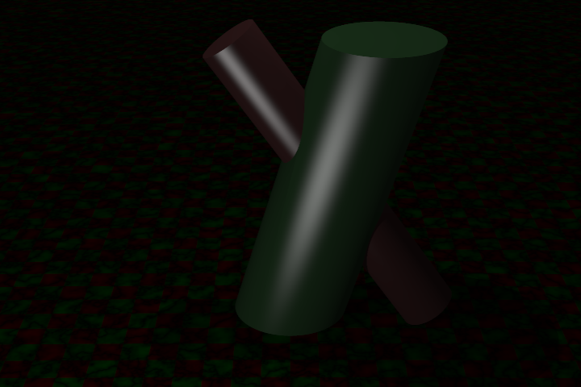

# rayTracingWithCUDA

用 C++ 和 CUDA 实现的三维光线追踪渲染演示程序。通过 NVIDIA GPU 按像素并行计算光线路径，在 Win32 窗口中展示三维场景，并支持图片保存与视频导出。

项目时间：2026 年 7 月；独立完成。



[查看随项目提供的示例视频](docs/demo.mp4)

> 预览图和视频来自原始项目压缩包中已有的渲染结果。预览展示圆柱光照场景；当前源码的默认入口使用模型组合场景，两者不是同一个场景。

## 功能

- **GPU 渲染**：每个 CUDA 线程计算一个像素，使用 cuRAND 生成随机采样，支持多次光线散射、反射和折射。
- **几何与模型**：球体、三角形、圆柱和 OBJ 三角网格；支持生成贝塞尔与 B 样条曲面的三角网格。
- **材质与纹理**：漫反射、金属、玻璃，纯色、BMP 图片、棋盘格与 Perlin 噪声纹理，以及发光材质。
- **画质与求交加速**：子像素抗锯齿、景深、BVH 包围盒树；可以切换包围盒显示。
- **交互与输出**：键盘控制相机位置、姿态、采样数量和追踪深度，保存 BMP，将连续帧编码为 H.264/MP4。

## 环境

| 组件 | 当前工程配置或依赖 |
| --- | --- |
| 系统 | Windows，建议使用 x64 配置 |
| 显卡 | 支持 CUDA 的 NVIDIA GPU，并安装与 Toolkit 匹配的驱动 |
| IDE | Visual Studio 2022，MSVC v143，安装“使用 C++ 的桌面开发” |
| Windows SDK | 工程目标为 Windows SDK 10.0 |
| CUDA | CUDA Toolkit 12.8，包含 Visual Studio 集成和 cuRAND 头文件 |
| 视频库 | FFmpeg 的 avcodec、avformat、avutil、swscale，以及可用的 H.264 编码器 |

源码没有 CPU 渲染后端，也没有规定最低显存容量。模型规模、窗口分辨率、采样数量和光线追踪深度都会影响资源需求和渲染时间。

## 编译与运行

1. 安装 Visual Studio 的 C++ 桌面开发组件、Windows SDK 和 CUDA Toolkit 12.8。确认 Visual Studio 能找到 `CUDA 12.8.props` 与 `CUDA 12.8.targets`。
2. 准备 FFmpeg 开发库。原始构建记录使用 vcpkg 的 `x64-windows` 库，可以在已有的 vcpkg 目录运行：

   ```powershell
   .\vcpkg.exe install "ffmpeg[avcodec,avformat,swscale,x264]:x64-windows" --recurse
   .\vcpkg.exe integrate install
   ```

   此命令使用 vcpkg 的经典模式。`x264` 功能提供 H.264 编码器；只有 FFmpeg 头文件或一个 `ffmpeg.exe` 不足以完成工程编译。vcpkg 的用户级 MSBuild 集成会配置库路径，并处理运行时 DLL 的复制。
3. 打开根目录下的 `rayTracingWithCUDA.sln`，选择 **Release / x64**。
4. 在项目属性的 **调试 → 工作目录** 中设置 `$(ProjectDir)`。模型和贴图使用相对路径，工作目录必须能找到 `obj/`、`ImageTexture/` 和 `frame/`。
5. 生成项目并运行。如果没有使用 vcpkg 集成，请自行配置 FFmpeg 的头文件、库目录、链接库，并让相应 DLL 能被程序找到。CUDA 运行库同样需要正确链接。

当前 `.vcxproj` 固定引用 CUDA 12.8。使用其他 CUDA 版本时，需要调整对应的构建自定义项，并确认该版本与 MSVC 工具链兼容。

## 键盘操作

| 按键 | 功能 |
| --- | --- |
| W / A / S / D | 相机前后左右移动 |
| 空格 / Ctrl 或 Shift | 相机上移 / 下移 |
| 方向键 | 调整相机朝向 |
| `[` / `]` | 调整相机横滚 |
| `+` / `-` | 调整焦距相关参数 |
| 9 / 0 | 减小 / 增大景深镜头角度参数 |
| J / K | 减少 / 增加每个方向的子像素数 |
| O / P | 减少 / 增加光线追踪深度 |
| F | 切换包围盒显示 |
| Backspace | 切换背景光照设置 |
| G / H | 切换 720×480 / 1080×720 窗口渲染尺寸 |
| Tab | 保存当前画面为 `output.bmp` |
| Enter | 开关逐帧录制；达到 100 帧后合成为 `output.mp4` |
| 1 / 2 | 调整场景时间参数 |
| U / I、N / M、Z / X | 分别调节移动、旋转、时间参数的变化速度 |

子像素参数为 N 时，每个像素计算 N×N 条初始光线。视频编码设置为 30 FPS，这个数值是输出视频的播放帧率，不是程序的实时渲染速度。窗口重绘时计算帧，录制逻辑目前固定为 100 帧。

## 场景

`rayTracingWithCUDA.cpp` 中 `rander(..., 1)` 的最后一个参数选择场景；修改它后重新编译。`rayTracing.cu` 的 `createWorld` 包含以下场景：

| 编号 | 场景 |
| --- | --- |
| 0 | Minecraft 角色模型及贴图 |
| 1 | 佛像、手、兔子、犰狳等模型与玻璃球的组合场景（当前默认） |
| 2 | 球体与材质、纹理示例 |
| 3 | 随机球体场景 |
| 4 | 控制点与 B 样条曲面示例；也保留了贝塞尔曲面生成函数 |
| 5 | 模型与点光源示例 |
| 6 | 球体与点光源示例 |
| 7 | 圆柱与移动点光源示例 |

部分示例依赖源码中注释标出的相机初始位置。直接切换编号可能需要同时调整相机；点光源的简化光照分支使用追踪深度 2。

## 目录与实现

```text
rayTracingWithCUDA.sln
rayTracingWithCUDA/
  rayTracingWithCUDA.cpp       # Win32 窗口、键盘交互、图片/录制入口
  rayTracing.cu               # CUDA 渲染核函数、场景构建、OBJ 与曲面加载
  RayHit.cuh                 # 光线求交、材质、纹理、BVH、相机
  rayVector.cuh / vector3.cuh # 向量运算与随机采样
  createvideo.cpp            # BMP 保存与 FFmpeg 视频编码
  obj/                       # OBJ 模型与网格转换辅助脚本
  ImageTexture/              # 纹理资源
  frame/                     # 运行时生成的 BMP 帧；仓库保留空目录
docs/
  preview.png
  demo.mp4
```

## 项目状态

仓库保留原始算法实现与资源，增加了说明、忽略规则和演示文件；移除了编译中间文件、构建日志和批量输出帧。本次整理没有在完整 CUDA/FFmpeg 环境中重新编译或进行性能基准测试，因此没有提供加速倍数或实时帧率结论。

工程可作为光线追踪、GPU 编程与计算机图形学的学习和演示项目。现有代码仍有改进空间，例如资源释放、错误处理与场景切换界面。

## 资源与依赖说明

`obj/` 与 `ImageTexture/` 的模型及贴图随原始项目提供，原始压缩包未附带其来源或许可证说明。这里保留这些资源用于复现项目，未将其标注为作者原创，也未为整个仓库擅自添加统一开源许可证。FFmpeg、CUDA 和相关第三方资源遵循各自的许可条款。

安装参考：[vcpkg 的 FFmpeg 功能定义](https://github.com/microsoft/vcpkg/blob/master/ports/ffmpeg/vcpkg.json)、[vcpkg 的 MSBuild 集成文档](https://learn.microsoft.com/en-us/vcpkg/users/buildsystems/msbuild-integration)。
